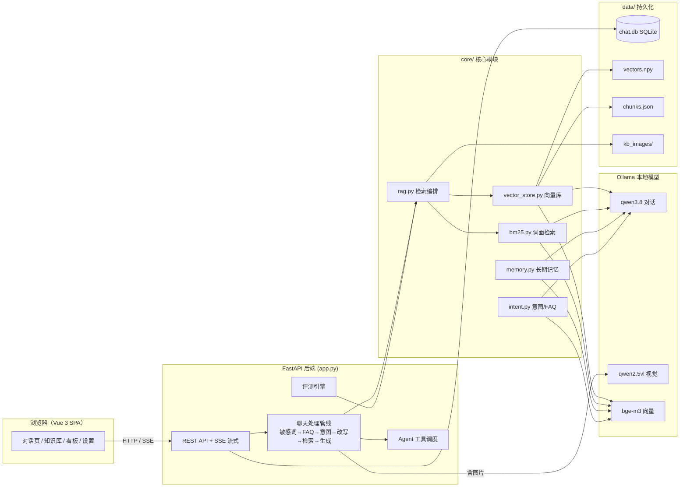
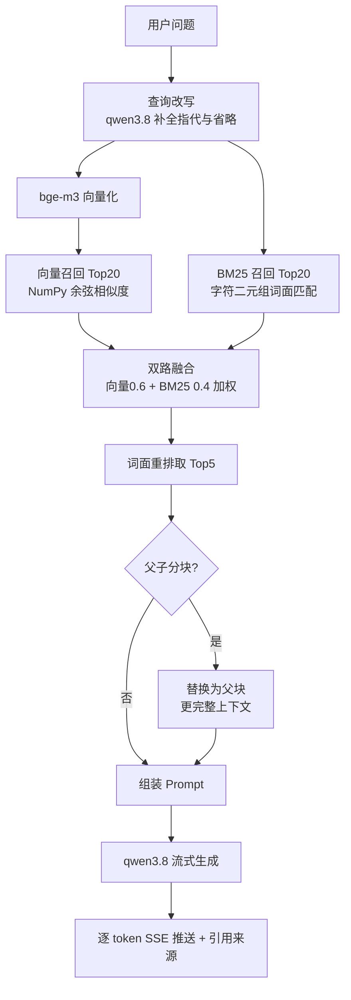
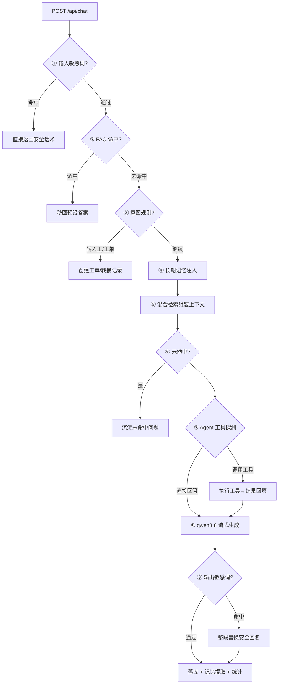

# RAG AI 客服系统

基于本地大模型的企业级智能客服系统：私有知识库问答、多模态对话、Agent 工具调用、长期记忆、评测闭环与统计看板。**纯本地部署，零外部服务依赖**。

## 功能特性

- **知识库问答**：文档上传（txt/md/docx/doc/xlsx/xls/pdf）、URL 网页导入、多知识库分组管理
- **RAG 检索管线**：查询改写 → 向量召回 + BM25 混合检索 → 重排 → Top5 上下文组装，支持父子分块
- **多模态对话**：聊天图片问答（视觉模型）、图片知识库（图片自动理解入库，命中后带原图回答）
- **Agent 工具调用**：知识库检索 / 计算器 / 时间 / 天气，模型自动决策调度，失败自动降级
- **客服中台能力**：FAQ 快捷回复、意图识别转工单、转人工、敏感词双向过滤、未命中问题沉淀
- **长期记忆**：超 12 轮自动摘要压缩，跨会话提取用户偏好与事实注入上下文
- **评测闭环**：问答日志一键沉淀评测集，回归测试走完整线上管线并语义打分
- **统计看板**：问答量/反馈趋势、赞踩占比、耗时分布、知识库健康度（纯手绘 SVG 图表）
- **对话体验**：SSE 流式输出、阶段提示、引用来源可点击跳转到原文分块、会话导出 Markdown

## 技术栈

| 层 | 技术 |
|---|---|
| 前端 | Vue 3 组件化 SPA（单文件、无构建、零 CDN），纯手绘 SVG 图表 |
| 后端 | FastAPI + SSE 流式响应 |
| 大模型 | Ollama 本地运行：qwen3.8（对话）、qwen2.5vl（视觉）、bge-m3（向量） |
| 向量检索 | 纯 NumPy 余弦相似度 + 纯 Python BM25 双路召回融合 |
| 存储 | SQLite（会话/日志/配置）+ NumPy 向量文件 + JSON 分块索引 |

## 系统架构



## RAG 检索流程



## 聊天请求处理管线



## 目录结构

```
rag-BOT/
├── app.py                  # FastAPI 入口：全部 API 路由 + SSE 聊天管线
├── config.py               # 全局配置（模型、分块参数、路径）
├── db.py                   # SQLite 数据访问层（会话/日志/FAQ/工单/评测集）
├── core/
│   ├── rag.py              # RAG 编排：改写、混合检索、重排、Prompt 组装
│   ├── vector_store.py     # 纯 NumPy 向量库（余弦相似度，持久化 npy+json）
│   ├── bm25.py             # 纯 Python BM25（字符二元组）
│   ├── chunker.py          # 文本切分：定长重叠 / 父子分块
│   ├── parser.py           # 多格式文档解析（txt/md/docx/xlsx/pdf）
│   ├── ollama_client.py    # Ollama 客户端：嵌入 / 流式对话 / 多模态
│   ├── memory.py           # 长期记忆：摘要压缩 + 偏好提取
│   ├── intent.py           # FAQ 匹配 + 意图识别 + 工单/转人工
│   ├── tools.py            # Agent 工具注册表与调度
│   └── settings.py         # 运行时设置（提示词/敏感词/检索参数）
├── static/
│   ├── index.html          # Vue 3 单文件前端（全部页面与组件）
│   └── vendor/             # 本地化 Vue 运行时（零 CDN）
└── data/                   # 运行时数据（SQLite / 向量 / 分块 / 图片）
```

## 快速开始

```bash
# 1. 安装依赖（Python 3.10+）
pip install -r requirements.txt

# 2. 安装并启动 Ollama，拉取模型
ollama pull bge-m3
ollama pull qwen3.8
ollama pull qwen2.5vl:3b

# 3. 启动服务
python app.py        # 或双击 start.bat（Windows）

# 4. 打开浏览器
http://localhost:8008
```

## 核心设计

- **零重型框架**：不依赖 LangChain / 向量数据库 / 图表库，检索与可视化全部手写，便于理解与可控调优
- **双路召回**：向量（语义）+ BM25（词面）加权融合，兼顾"意思相近"与"关键词精确"两类问题
- **父子分块**：小块（~400字）负责检索精度，命中后替换为父块（~1500字）保证上下文完整性
- **降级容错**：工具探测失败自动降级为直接对话；视觉模型场景跳过 Agent 探测保证稳定性
- **评测驱动**：badcase 一键沉淀为评测集，回归测试用语义相似度打分，量化每次改动的影响
