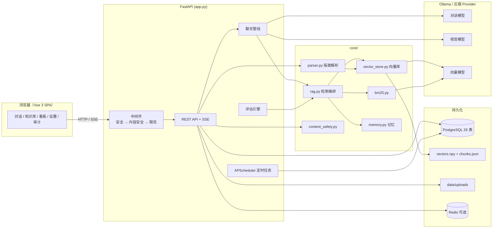
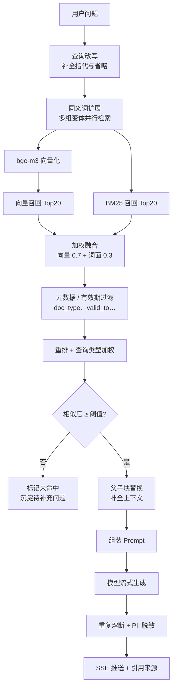
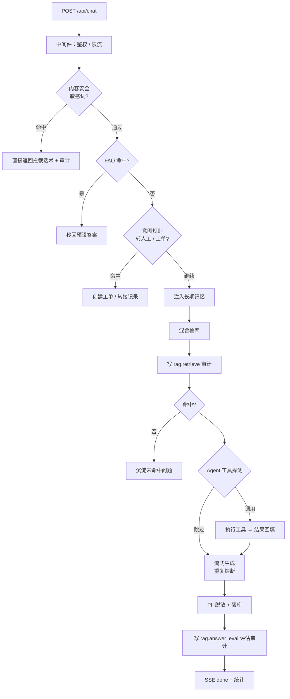

# RAG 智能客服知识库系统

面向内网私有化部署的智能客服 / 知识库问答系统：本地大模型推理、混合检索、多模态问答、客服中台能力、评测与审计闭环。**数据不出内网**，除 Ollama 之外无强制外部依赖。

当前后端已迁移到 **PostgreSQL + SQLAlchemy**（Alembic 管理 26 张表），向量检索仍为自研 NumPy 实现，不依赖任何向量数据库。

---

## 功能特性

### 知识库与检索
- **多格式入库**：txt / md / docx / doc / xlsx / xls / pdf / pptx / ppt，以及 URL 网页导入、图片知识库
- **版面感知分块**：按标题边界切分，单块上限 800 字 / 3 张图，保留页码、表格与图文配对
- **Excel 行级语义化**：每行数据额外生成一条自然语言描述（如 `[工作表: 产品参数] 型号 A200，价格 499`），提升表格检索命中率
- **混合检索**：向量召回 + BM25 词面召回，加权融合后重排
- **同义词扩展**：一次提问自动展开多组领域同义词，多路检索后合并去重；词典可在后台编辑，保存即生效（按 mtime 热加载）
- **元数据过滤**：`doc_type` / `source_path` / `heading_path` / `valid_from` / `valid_to` 等字段参与过滤；支持按知识库、文档类型、有效期收窄检索范围
- **知识时效治理**：`valid_to` 过期文档自动不再被召回；上传同名文档按「同 kb_id + 文件名」原子替换（先构建新向量，再删旧加新）
- **父子分块**：小块负责检索精度，命中后回溯父块补全上下文

### 对话
- **SSE 流式输出**：逐 token 推送，含阶段提示与可点击引用来源
- **多模态问答**：图片理解（qwen2.5vl）+ 图文统一向量（2048 维）
- **重复熔断**：流式生成中实时检测自我重复，命中后立即中断，避免小模型陷入循环
- **长期记忆**：轮数（>12 轮）或 token 预算（>3000）双阈值触发摘要压缩，跨会话提取用户偏好
- **会话管理**：重命名、删除、导出 Markdown

### 客服中台
- FAQ 快捷回复、意图规则识别、转工单、转人工、未命中问题沉淀
- 内容安全：输入敏感词拦截 + 输出 PII 脱敏（手机号 / 身份证 / 银行卡 / 邮箱）
- Agent 工具调用：知识库检索 / 计算器 / 时间 / 天气，模型自动决策，失败自动降级为直接对话

### 质量与可观测
- **检索命中审计**：每次提问落 `rag.retrieve`，记录问题、是否命中、来源文档与分数
- **回答质量评估**：`rag.answer_eval` 记录 faithfulness / answer_relevance / context_precision；有 Ollama 时走 LLM-as-Judge，不可用时自动降级为词面打分
- **评测闭环**：badcase 一键沉淀评测集，回归测试走完整线上管线
- **运行可观测**：Prometheus `/metrics`、请求 trace、健康检查、成本统计、错误率与延迟告警
- **定时任务**：APScheduler 负责健康巡检（5 分钟）、会话清理（30 分钟）、知识库文件扫描与增量重建（24 小时）
- **审计日志**：登录、知识库操作、权限变更、检索与评估全量落库，支持筛选与导出

### 权限与安全
- JWT 登录、密码强度策略、密码历史校验、登录失败锁定
- RBAC：角色 / 权限目录、组织与部门、用户角色分配、强制下线
- 会话级撤销（Redis 可用时跨进程生效）
- 所有凭据通过 `.env` 注入，非 `dev` 环境缺失口令或密钥时**启动即失败**

---

## 技术栈

| 层 | 技术 |
|---|---|
| 前端 | Vue 3 单文件 SPA（无构建、无 CDN，本地 vendor） |
| 后端 | FastAPI + SSE（114 个 REST 路由） |
| 数据库 | PostgreSQL 17 + SQLAlchemy 2.x ORM + Alembic 迁移 |
| 缓存/队列 | Redis（可选，缺失时退化为内存/DB） |
| 大模型 | Ollama：`qwen2.5:3b-instruct` 对话、`qwen2.5vl:3b` 视觉、`bge-m3` 文本向量、`batiai/qwen3-vl-embed-2b` 图文向量 |
| 模型接入 | Provider 抽象：Ollama / OpenAI 兼容 / 百度文心 / 阿里 DashScope |
| 检索 | NumPy 余弦相似度 + 纯 Python BM25 + 加权融合 + 重排 |
| 调度 | APScheduler（进程内） |
| 监控 | prometheus-client + 自定义审计 / trace 表 |

---

## 系统架构



---

## RAG 检索流程



---

## 聊天处理管线



---

## 目录结构

```
rag-BOT/
├── app.py                    # FastAPI 入口：114 个路由 + SSE 聊天管线 + 定时任务
├── config.py                 # 运行时配置（模型、分块、路径、生成参数）
├── db.py                     # 数据访问层（SQLite 实现，末尾按 DB_DRIVER 覆盖为 PG）
├── db_pg.py                  # PostgreSQL ORM 实现（核心 20+ 函数）
├── core/
│   ├── config.py             # pydantic-settings 配置（.env 注入 + 生产校验）
│   ├── models.py             # SQLAlchemy 模型（26 张表，JSONB 字段）
│   ├── db_engine.py          # 引擎 / 连接池 / Session
│   ├── rag.py                # 检索编排：改写、同义词扩展、融合、重排、Prompt
│   ├── vector_store.py       # NumPy 向量库：增删改查、metadata 过滤、有效期过滤
│   ├── bm25.py               # 纯 Python BM25
│   ├── chunker.py            # 定长 / 父子分块
│   ├── parser.py             # 版面感知解析（PDF/DOCX/PPTX/XLSX + OCR）
│   ├── ollama_client.py      # 嵌入 / 流式对话 / 多模态
│   ├── llm_provider.py       # 多 Provider 抽象与降级
│   ├── memory.py             # 长期记忆：token 估算 + 双阈值摘要
│   ├── intent.py             # FAQ / 意图 / 工单 / 转人工
│   ├── tools.py              # Agent 工具注册表
│   ├── ragas_eval.py         # LLM-as-Judge 评估（含词面兜底）
│   ├── content_safety.py     # 敏感词 + PII 脱敏中间件
│   ├── auth.py               # JWT / 会话 / Redis 会话同步
│   ├── acl.py                # 权限校验
│   ├── security.py           # 安全中间件 + 审计
│   ├── metrics.py            # Prometheus 指标
│   ├── alerts.py / health.py # 告警与健康检查
│   ├── async_queue.py        # 异步任务队列（Redis 或本地）
│   ├── cost_tracker.py       # token / 成本统计
│   ├── tracing.py            # 请求链路追踪
│   └── settings.py           # 运行时设置（提示词、检索参数、敏感词）
├── alembic/                  # 数据库迁移（26 表初始版本）
├── static/
│   ├── index.html            # Vue 3 单文件前端
│   └── vendor/vue.global.prod.js
├── data/                     # 运行时数据（忽略提交）
│   ├── uploads/              # 上传原文档
│   ├── vectors.npy           # 向量矩阵
│   ├── chunks.json           # 分块与 metadata
│   ├── synonyms.json         # 同义词词典
│   ├── kb_images/            # 图片知识库
│   └── logs/                 # 应用日志
├── Dockerfile / docker-compose.yml / nginx.conf / entrypoint.sh
├── .env.example              # 环境变量模板
└── requirements.txt
```

---

## 快速开始

### 1. 环境要求

- Python 3.10+（开发环境使用 3.12）
- PostgreSQL 14+（推荐 17）
- Ollama（本地或内网独立部署）
- 可选：Redis 7（多实例部署时建议开启）

### 2. 安装依赖

```bash
python -m venv .venv
.venv\Scripts\activate        # Windows
pip install -r requirements.txt
```

### 3. 创建数据库并迁移

```sql
CREATE DATABASE rag_bot;
```

```bash
alembic upgrade head
```

首次启动会自动创建默认账号（见下方「默认账号」）。

### 4. 配置 .env

```bash
copy .env.example .env        # Windows
cp .env.example .env          # Linux / macOS
```

最少需要修改三项：

```ini
APP_ENV=prod
DB_PASSWORD=你的数据库口令
JWT_SECRET=用 openssl rand -hex 32 生成的随机串
```

`APP_ENV` 不是 `dev` 时，口令或密钥为空会直接启动失败。

### 5. 准备模型

```bash
ollama pull bge-m3
ollama pull qwen2.5:3b-instruct
ollama pull qwen2.5vl:3b
ollama pull batiai/qwen3-vl-embed-2b:q6   # 图片知识库需要
```

> 显存 ≥ 24G 时建议把对话模型换成 14B 级别（改 `config.py` 的 `CHAT_MODEL`），质量提升明显。

### 6. 启动

```bash
uvicorn app:app --host 0.0.0.0 --port 8008
```

或双击 `start.bat`（需先把里面的 Python 路径改成你自己的）。

### 7. 访问

浏览器打开 `http://localhost:8008`。

**默认账号**（首次初始化数据库时创建，登录后请立即修改）：

| 账号 | 密码 | 角色 |
|------|------|------|
| `admin` | `admin123` | superadmin |
| `user` | `user123` | user |

### Docker 方式

```bash
docker compose up -d --build
```

包含 PostgreSQL、Redis、Ollama、后端、Nginx 五个服务，首次启动需进入 ollama 容器拉取模型。

---

## 配置说明

| 变量 | 默认值 | 说明 |
|------|--------|------|
| `APP_ENV` | `dev` | `prod` 时强制校验数据库口令与 JWT 密钥 |
| `DB_DRIVER` | `postgresql` | 设为 `sqlite` 可退回单文件模式 |
| `DB_HOST` / `DB_PORT` / `DB_NAME` / `DB_USER` / `DB_PASSWORD` | — | PostgreSQL 连接信息，口令只放 `.env` |
| `REDIS_URL` | 空 | 留空则限流与会话退化为内存 / DB |
| `JWT_SECRET` | 空 | 生产必填，随机字符串 |
| `LLM_PROVIDER` | `ollama` | 可选 `openai_compat` / `baidu_ernie` / `aliyun_dashscope` |
| `OLLAMA_HOST` | `http://localhost:11434` | Ollama 地址 |
| `CONTENT_SAFETY_ENABLED` | `false` | 开启输入敏感词拦截与输出 PII 脱敏 |
| `CONTENT_BLOCKED_WORDS` | 空 | 追加敏感词，逗号分隔 |
| `METRICS_ENABLED` | `true` | 暴露 `/metrics` |
| `ALERT_WEBHOOK_URL` | 空 | 错误率 / P99 超阈值时推送告警 |
| `ASYNC_QUEUE_ENABLED` | `true` | 文档入库异步化 |

检索与生成参数在 `config.py`：`TOP_K=5`、`SCORE_THRESHOLD=0.35`、`CHUNK_SIZE=500`、`CHAT_TEMPERATURE=0.3`、`CHAT_REPEAT_PENALTY=1.3`、`CHAT_NUM_PREDICT=1024`。

---

## 运维与排查

| 需求 | 位置 |
|------|------|
| 运行日志 | `data/logs/rag.log`，或后台「系统日志」（按级别着色） |
| 业务审计 | 后台「安全审计」→ 审计页，动作含 `rag.retrieve`、`rag.answer_eval`、`kb.metadata.update`、`auth.login.*` |
| 指标 | `GET /metrics`（Prometheus 格式） |
| 健康检查 | `GET /api/health` |
| 链路追踪 | 后台 trace 查询，或 `GET /api/traces` |
| 成本 | `GET /api/admin/cost/me`、`/api/admin/cost/global` |
| 定时任务 | 启动日志 `APScheduler started (health=5m, cleanup=30m, kb_doc_scan=24h)` |

---

## 核心设计取舍

- **不引入向量数据库**：NumPy 全量矩阵 + 余弦相似度，几十万 chunk 内延迟可控，部署零额外组件
- **不引入重型编排框架**：无 LangChain / LlamaIndex，检索与 Prompt 组装全部显式可读，便于针对业务调参
- **同一套接口兼容 SQLite / PostgreSQL**：`db.py` 保持签名不变，启动时按 `DB_DRIVER` 覆盖为 ORM 实现，历史调用方零改动
- **降级优先**：评估无 LLM 时退化为词面打分；工具探测失败降级直答；Redis 缺失降级内存
- **凭据与代码分离**：所有口令、密钥走 `.env`；`.env`、上传文档、向量文件、日志均不进版本库

---

## 已知边界与后续方向

| 项 | 现状 |
|----|------|
| 模型效果 | 默认 3B 模型质量有限；建议 48G 显存环境换 14B，并接入 cross-encoder 重排 |
| 检索隔离 | 已有组织 / 部门 / 角色数据模型，但检索链路尚未按组织强制过滤 |
| 内容安全 | 当前为关键词 + 正则 + 提示词约束的轻量实现，未接入安全分类模型 |
| 并发扩展 | 单机单进程为主；多 worker 需开启 Redis，并把向量库与任务队列改为共享存储 |
| 数据加密 | 未做文档级加密与逐用户独立索引；同态加密检索经评估成本过高，暂不实施 |
| 入库方式 | 仅支持本地上传与 URL 导入，未接入 Confluence / 飞书 / 网盘等增量同步 |
